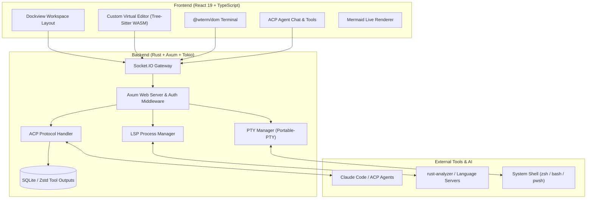
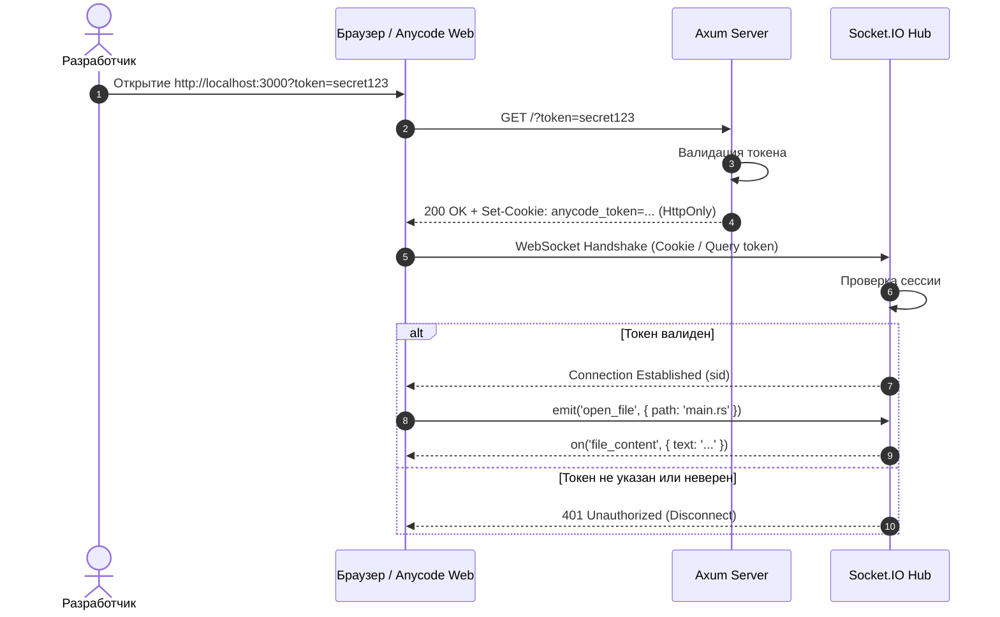
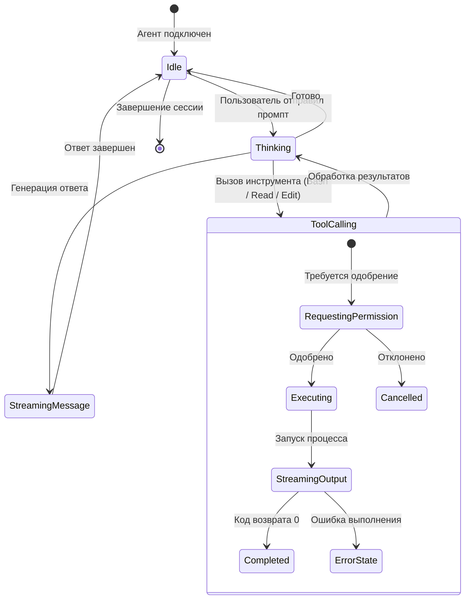
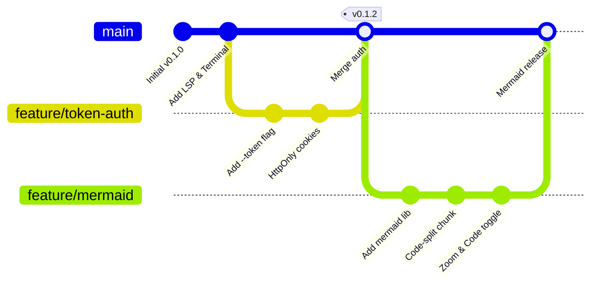
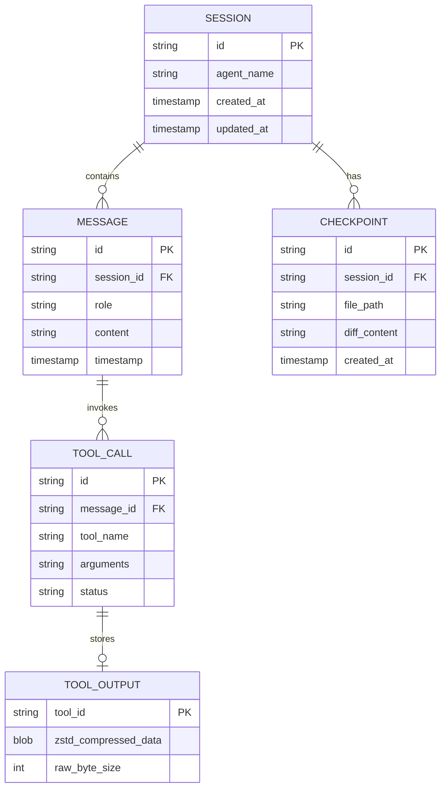

# 🎨 Anycode Mermaid Diagrams Showcase

Этот файл предназначен для проверки и демонстрации рендеринга Mermaid-диаграмм в Markdown Preview и чате Anycode.

---

## 1. Архитектура Anycode (Flowchart)

---

## 2. Протокол Аутентификации (Sequence Diagram)

---

## 3. Жизненный цикл задачи AI Агента (State Diagram)

---

## 4. Ветвление релизов (Git Graph)

---

## 5. Структура БД сессий ACP (Entity Relationship)

