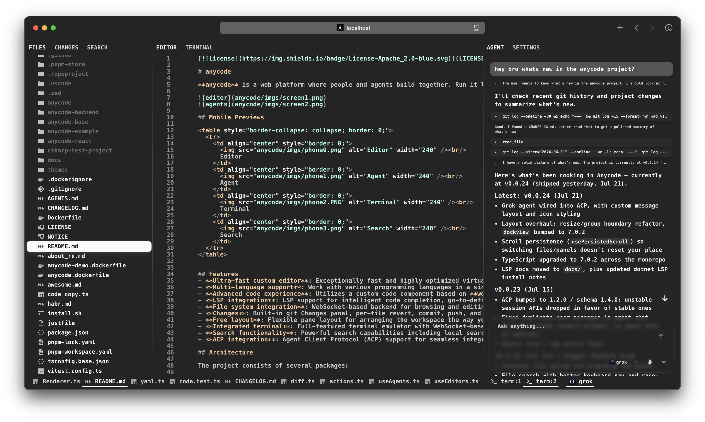
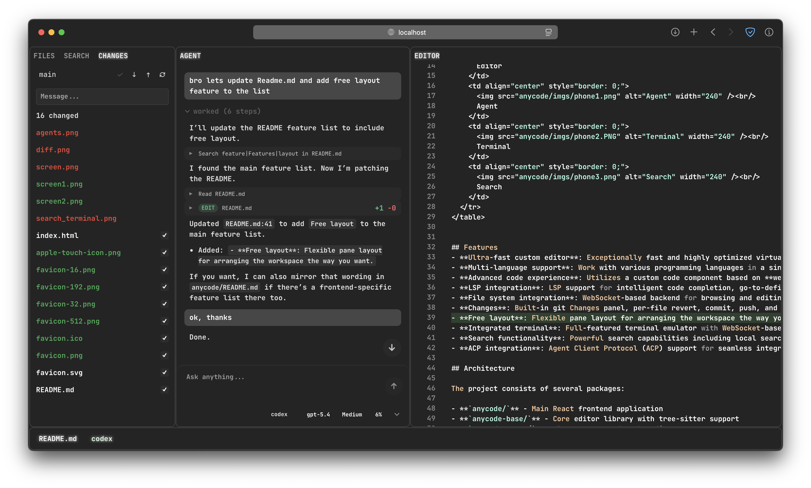
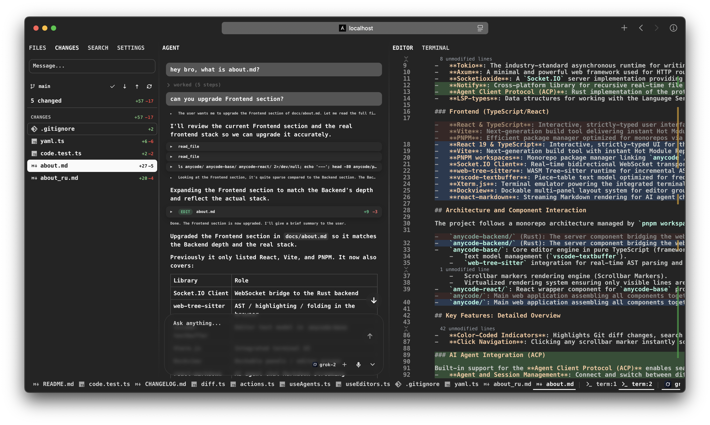

[](LICENSE)

# anycode

**anycode** is a web platform where people and agents build together. Run it locally or remotely and work from any device you want: desktop, laptop, mobile, or even VR. Use any agent, including Codex, Claude Code, OpenCode, as well as local models.





## Features
- **Ultra-fast custom editor**: Exceptionally fast and highly optimized virtual rendering engine based on tree-sitter parser, delivering superior performance for large codebases. 
- **Multi-language support**: Work with various programming languages in a single environment.
- **Advanced code experience**: Utilizes a custom code component based on **web-tree-sitter** for efficient parsing, syntax highlighting, and real-time code analysis.
- **LSP integration**: LSP support for intelligent code completion, go-to-definition, hover information and real-time diagnostics.
- **File system integration**: WebSocket-based backend for browsing and editing files from your local filesystem.
- **Changes**: Built-in git Changes panel, per-file revert, commit, push, and pull with status feedback.
- **History**: Browse Git commit history for the repository or current file, inspect changes, and open previous versions.
- **Free layout**: Flexible pane layout for arranging the workspace the way you want.
- **Integrated terminal**: Full-featured terminal emulator with WebSocket-based communication, supporting real-time command execution and output.
- **Search functionality**: Powerful search capabilities including local search within files and global search across project.
- **Markdown Preview & Mermaid Diagrams**: Live synchronized markdown preview with full Mermaid diagram rendering (flowcharts, sequence diagrams, state, class, ER, Git graphs), diagram/code view toggle, interactive zoom, and copy controls.
- **ACP integration**: Agent Client Protocol (ACP) support for seamless integration with AI agents, including tool-call streaming, history-backed undo, session resume, frontend-controlled permission mode, model and reasoning selectors, streamed markdown and code blocks, markdown file links, interactive Mermaid diagrams in chat, and improved tool-call diff display.

## Architecture

The project consists of several packages:

- **`anycode/`** - Main React frontend application and Tauri desktop app
- **`anycode-base/`** - Core editor library with tree-sitter support
- **`anycode-react/`** - React wrapper for the editor
- **`anycode-backend/`** - Rust backend for file system access
- **`anycode-example/`** - Example application demonstrating anycode usage

## Installation

### Desktop Application

Download the prebuilt native installer for your operating system from [GitHub Releases](https://github.com/anycode-ade/anycode/releases).

#### 🍏 macOS
1. Download the `.dmg` matching your Mac architecture:
   - **Apple Silicon** (M1/M2/M3/M4): `anycode-desktop-macos-arm64.dmg`
   - **Intel**: `anycode-desktop-macos-x64.dmg`
2. Open the `.dmg` and drag `anycode.app` to your **Applications** folder.
3. **First launch (Gatekeeper approval):**  
   Because community builds are not notarized through Apple's paid program, macOS may show a *"cannot be opened because the developer cannot be verified"* warning.
   - **Quick fix via Terminal:**
     ```bash
     xattr -cr /Applications/anycode.app
     ```
   - **Or via Finder:** Right-click (or Control-click) `anycode.app` in `/Applications`, click **Open**, then click **Open** in the confirmation prompt.

---

#### 🪟 Windows (10 / 11)
1. Download `anycode-desktop-windows-x64-setup.exe`.
2. Double-click the installer and follow the setup wizard.
3. **Microsoft Defender SmartScreen prompt:**  
   Windows Defender may show a blue prompt stating *"Windows protected your PC"*.
   - Click **More info** (*Подробнее*).
   - Click **Run anyway** (*Выполнить в любом случае*).
   *(Anycode utilizes Microsoft Edge WebView2, which is already built into modern Windows 10/11).*

---

#### 🐧 Linux

##### Option 1: Debian / Ubuntu / Mint / Pop!_OS (`.deb`)
1. Download `anycode-desktop-linux-amd64.deb`.
2. Install via terminal:
   ```bash
   sudo dpkg -i anycode-desktop-linux-amd64.deb
   sudo apt-get install -f # ensures system webkit2gtk dependency is satisfied
   ```
   Or double-click the `.deb` file in your desktop file manager to install through the Software Center.

##### Option 2: Arch / Fedora / Generic Linux (`.tar.gz`)
1. Download `anycode-desktop-linux-x86_64.tar.gz`.
2. Extract and run anywhere:
   ```bash
   tar -xzf anycode-desktop-linux-x86_64.tar.gz
   ./anycode-desktop
   ```
3. *Requirement:* Ensure WebKitGTK is installed on your distribution:
   - **Arch / Manjaro:** `sudo pacman -S webkit2gtk-4.1`
   - **Fedora / RHEL:** `sudo dnf install webkit2gtk4.1`

---

### CLI & Server (From releases)

#### macOS and Linux one-shot installer:
```bash
curl -fsSL https://raw.githubusercontent.com/anycode-ade/anycode/main/install.sh | sh
```

#### Windows PowerShell installer (x64):
```powershell
irm https://raw.githubusercontent.com/anycode-ade/anycode/main/install.ps1 | iex
```

Windows installer details:
- Installs `anycode.exe` into `%USERPROFILE%\AppData\Local\anycode\bin` by default
- Adds that directory to the user `PATH` if needed
- Supports overrides via `ANYCODE_VERSION`, `ANYCODE_INSTALL_DIR`, and `ANYCODE_REPO`
- Current release installer targets Windows x64; Windows ARM64 can still build from source

## Usage

Start `anycode` from any project directory:

```bash
anycode
```

### Options & Security

| Flag | Env Variable | Default | Description |
|---|---|---|---|
| `-p, --port <PORT>` | `ANYCODE_PORT` | `3000` | Port to listen on |
| `-t, --token <TOKEN>` | `ANYCODE_TOKEN` | _None_ | Require access token to access web UI and WebSocket |

#### Access Token Protection

When hosting `anycode` on a remote machine, cloud instance, or local network, protect your workspace by setting a token:

```bash
anycode --token mysecret
# or with short flag and custom port:
anycode -t mysecret -p 8080
```

The server will print an authenticated URL:
```text
INFO Starting anycode at http://localhost:8080
INFO Access token protection enabled.
INFO Open with token: http://localhost:8080?token=mysecret
```

Any attempt to access the web interface or WebSocket without the token will be rejected with `401 Unauthorized`. Once opened with `?token=...`, the browser securely stores the session cookie for subsequent visits.

## Development

Prerequisites:
- Node.js 24+
- `pnpm`
- Rust 1.96.0+

1. **Install workspace dependencies:**
   ```bash
   pnpm install
   ```

2. **Start frontend:**
   ```bash
   cd anycode
   pnpm dev
   ```

3. **Build frontend assets for the backend:**
   ```bash
   cd anycode
   pnpm build
   ```

4. **Start Rust backend:**
   ```bash
   cd anycode-backend
   cargo run --release
   ```

5. **Run Desktop app in development:**
   ```bash
   pnpm --filter anycode tauri dev
   ```

## Contributing

We welcome contributions! Please fork the repository and submit a pull request with your changes. Make sure to follow the existing code style and include relevant tests.

## License

**anycode** is licensed under the Apache License, Version 2.0. See [LICENSE](LICENSE) for details.
